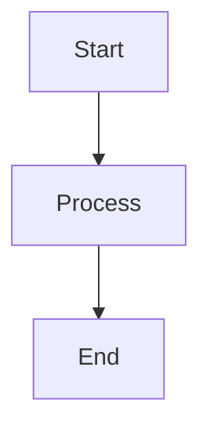

# Introduction to Java

Welcome to our interactive Java programming lecture.

In this lecture, we will explore the basics of Java, variables, mathematical formulas and program flow.

## 1. What is Java?

Java is a popular, object-oriented programming language. It is used for backend development, mobile applications and enterprise systems.

Java programs run on the Java Virtual Machine (JVM).

## 2. Variables

Variables store information in a program. Each variable has a type and a value.

```java
int age = 20;
String name = "Alex";
double height = 1.80;
```

## 3. Mathematical formulas

The Pythagorean theorem describes the relationship between the sides of a right triangle:

$$
a^2 + b^2 = c^2
$$

## 4. Program Flow

A simple program flow can be represented with a diagram:



## 5. Conclusion

In this lecture, we learned what Java is, how variables work, and how formulas and diagrams can be included in an interactive lecture.
